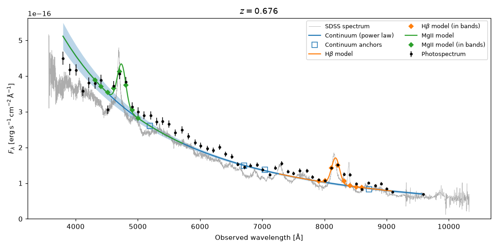

# quasar_lines

**Black hole virial masses from quasar photospectra.**

`quasar_lines` measures continuum luminosities and broad emission-line
properties (Hβ, MgII, CIV) from multi-narrow-band photometry — such as the
56-band J-PAS / miniJPAS surveys — and turns them into single-epoch virial
masses of supermassive black holes (SMBHs). It implements the method of
[Chaves-Montero et al. (2022)](#citation), *"Black hole virial masses from
single-epoch photometry: the miniJPAS test case"*.

<p align="center"></p>

## How it works

1. **Continuum.** A power law, `F_λ ∝ λ^α`, is fitted with MCMC to the
   photospectrum at rest-frame wavelengths largely free of line emission
   (1350, 1700, 1800, 2200, 3100, 4000, 4200, 5200 Å).
2. **Lines.** For each of Hβ, MgII, and CIV that falls within the observed
   range, a line profile (Gaussian by default) in units of the continuum is
   convolved with the filter transmission curves and fitted with MCMC to the
   continuum-normalised photospectrum. Bands contaminated by [OIII] and FeII
   are corrected.
3. **Black hole properties.** From the posterior we derive the line centre,
   FWHM, rest-frame EW, and continuum luminosity at 5100/3000/1350 Å, which
   enter the virial estimator

   `log(M_BH/M☉) = A + B [log(λL_λ / erg s⁻¹) − 44] + 2 log(FWHM / km s⁻¹)`.

   Bolometric luminosities and Eddington ratios are also provided.

See [docs/method.md](docs/method.md) for details.

## Installation

```bash
git clone https://github.com/jchavesmontero/bh_masses.git
cd bh_masses
pip install -e .            # library only
pip install -e ".[notebooks,test]"   # + jupyter, corner, pytest
```

or directly `pip install git+https://github.com/jchavesmontero/bh_masses.git`.
The package is imported as `quasar_lines`.

Dependencies: `numpy`, `scipy`, `astropy`, `emcee`, `matplotlib`.

## Quick start

```python
import quasar_lines as ql

# photospectra: fluxes in erg/s/cm2/A for the J-PAS bands + redshift
cat = ql.read_minijpas_catalog("examples/data/minijpas_qso_examples.cat")
filters = ql.load_jpas_filters(cat.band_names)   # bundled J-PAS filters

fit = ql.fit_photospectrum(cat.flux[0], cat.flux_err[0], cat.z[0], filters, rng=42)
print(fit.summary())
fit.black_hole_mass()   # {line: (log M_BH, error)}, e.g. {'Hbeta': (8.65, 0.27), 'MgII': (8.98, 0.79)}
ql.plot_fit(fit)
```

`fit_photospectrum` works with any set of photometric bands: pass your own
`ql.FilterSet(wavelength, transmission, names)`. The bands should be sorted by
wavelength and roughly evenly spaced, and fluxes must be in
erg s⁻¹ cm⁻² Å⁻¹.

For many sources, `ql.fit_catalog(flux, flux_err, z, filters)` returns a
structured array with all measurements; see
[scripts/run_catalog.py](scripts/run_catalog.py) for an MPI-parallel driver.

## Example notebook

[notebooks/example_jpas_fit.ipynb](notebooks/example_jpas_fit.ipynb) loads a
miniJPAS quasar, fits it, plots the result against its SDSS spectrum, and
computes the black hole mass.

## Package layout

```
src/quasar_lines/
├── fitting.py      # fit_photospectrum, fit_catalog, PhotoSpectrumFit  (start here)
├── continuum.py    # power-law continuum fit
├── lines.py        # emission-line fit and line properties
├── bh_mass.py      # virial masses, bolometric luminosity, Eddington ratio
├── filters.py      # FilterSet, J-PAS filters, synthetic photometry
├── profiles.py     # Gaussian and Nagao+06 line profiles
├── conversions.py  # magnitudes, fluxes, luminosities, widths
├── mcmc.py         # emcee helpers
├── io.py           # miniJPAS catalogues and SDSS spectra readers
├── plotting.py     # plot_fit, plot_line_posterior
└── data/jpas_filters.npz
examples/data/      # three miniJPAS quasars and their SDSS spectra
notebooks/          # example notebook
scripts/            # batch processing
tests/              # pytest suite
```

## Virial calibrations

| key | Hβ (A, B) | MgII (A, B) | CIV (A, B) | reference |
|---|---|---|---|---|
| `"chaves-montero22"` (default) | 0.876, 0.263 | 0.292, 0.590 | 0.894, 0.263 | recalibrated for photometry, Chaves-Montero et al. (2022) |
| `"shen11"` | 0.91, 0.50 | 0.74, 0.62 | 0.66, 0.53 | Vestergaard & Peterson (2006); Shen et al. (2011) |

The default recalibration was derived by matching miniJPAS photometric masses
to SDSS spectroscopic masses; it absorbs systematic differences between the
two approaches. Use `calibration="shen11"` for the standard spectroscopic
coefficients.

Differences from the code used in the paper: Eddington-ratio uncertainties now
account for the correlation between `M_BH` and `L_bol` (they are smaller), and
MCMC walkers are initialised uniformly over the central 80% of each prior.
Masses, luminosities, and line properties are unchanged within MCMC noise. Quoted mass errors only propagate measurement uncertainties;
virial estimators carry an additional ~0.3–0.4 dex intrinsic scatter.

## Tests

```bash
pytest
```

## Citation

If you use this code, please cite:

> Chaves-Montero, J., et al. 2022, *Black hole virial masses from single-epoch
> photometry: the miniJPAS test case*, A&A.

## License

MIT — see [LICENSE](LICENSE).
